# YongshangkeECommercePlatforms
电子商务平台
亮点：ECharts经营分析、订单与售后闭环、 营销与商品推荐、双角色经营协同；
角色：商家、管理员；

# 云商客 · 电子商务平台

> Vue 3 + Spring Boot 3 前后端分离，平台管理员与商家两个角色共用一套后台：商家管商品、营销、订单、物流、售后和经营统计，平台管商家准入、商品分类、结算账单和投诉处理。

做这套系统起因挺实在——身边的电商后台 demo 大多停在"商品列表 + 订单列表"两层，真到履约这一段就虚了。订单点发货之后库存怎么扣、取消订单库存怎么回补、退货退款要不要重新入库、平台抽成的比例从哪张表读、结算单上的"净营业额"到底减了什么，这些问题一问就容易卡住。所以这套东西把重点放在**订单履约链路**和**结算口径**上：从代客下单开始，到支付、发货、签收、售后处理，每一步都有对应的页面和状态；结算账单把营业金额、退款金额、净营业额、平台比例、平台金额、商家金额一列列摊开，能自己拿计算器核对。

## 技术栈

| 层次 | 技术选型 |
| --- | --- |
| 架构 | B/S、MVC、前后端分离、平台管理员 + 商家双角色权限 |
| 服务端 | Java 17、Spring Boot 3.3.1、Spring MVC、MyBatis-Plus、MySQL、JWT、Lombok |
| 前端 | Vue 3、Vite、Element Plus、Vue Router、Pinia、Axios、ECharts、AiEditor |
| 开发环境 | Windows、IDEA、Maven、Node.js |

## 功能亮点

**1. 双角色各管一摊**
商家端六个菜单组：商品管理（商品/营销活动/推荐商品/评论）、订单履约（订单/支付/物流/售后）、运营管理（首页运营/营销活动看板/购物清单/订单跟进）、经营协同（客户联系人/经营账单/经营统计）。平台端五个：商家管理（账号/店铺信息/经营类型/商家处罚）、商品分类、统计与结算（平台经营统计/经营账单）、投诉处理。同一套登录入口，按角色进不同菜单，商家只能看到自己店的数据。

**2. 订单履约链路**
订单从"购物清单"里的草稿开始——客服代客下单先把订单存成待支付草稿，客户付款后进待发货，商家发货并打印面单，客户签收后完成，中途可发起退货或换货。订单跟进页把待发货、待收货、已完成三个数字摆在顶部，每行直接显示订单状态、物流状态、物流单号和签收时间。

**3. 库存与订单联动**
商品表里同时有库存和销量两个字段。下单时扣库存加销量，取消或退款时反向回补，所以商品管理页看到的库存是实时值，不是手工填的静态数字。

**4. 营销活动两种玩法**
打折活动和秒杀活动分开维护：打折活动按商品基准价自动换算活动价，秒杀活动单独维护秒杀价和限量库存，两套逻辑不混在一起。页面顶部给出打折、秒杀、进行中三个计数，便于判断当前有多少活动在跑。

**5. 商品推荐排序**
推荐不是随手挑几个。页面上把规则写明了：当前排序分值 = 销量权重 + 下单热度 + 好评修正。销量权重让已完成订单的销量按更高权重参与排序，下单热度按订单明细出现次数累计，补足复购和持续下单的趋势，评价修正再结合好评评分占比调整，避免只看销量忽略口碑。

**6. 结算口径可核对**
经营账单按店铺和结算周期生成，一条记录包含订单数、营业金额、退款金额、净营业额、平台比例、平台金额、商家金额。净营业额等于营业金额减退款金额，平台金额等于净营业额乘平台比例，商家金额是剩下的部分。三个数一条线走下来，能直接验算。

**7. ECharts 经营分析**
商家端经营统计六张卡片给出总营收、总退款、净收入、总利润、有效订单数、动销商品数，下面四张图是分类营收、分类利润、近 7 日营收与利润趋势、热销商品排行。平台端有对应的平台经营统计视图，按店铺维度对比。

## 系统角色与界面

### 登录入口

管理员和商家共用一个登录页，账号、密码之外还要选角色（商家或平台管理员），底部注明"平台管理员 / 商家专属工作台"。左侧是商品与营销、订单与售后、经营与结算三段业务说明，右侧是登录表单，带商家注册和忘记密码入口。

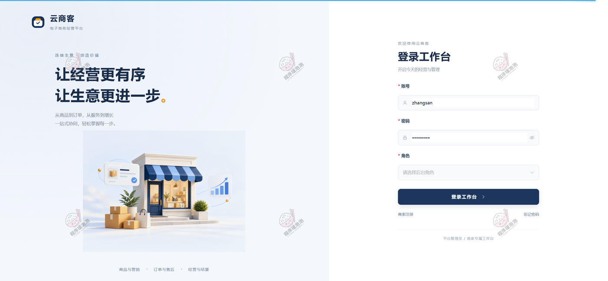

### 一、商家端（店铺经营后台）

登录后右上角显示当前账号（如 `merchant_tea`）和店铺名（青木茶舍）。

**商品管理**
按关键词、店铺、商品分类、商品状态、是否热门、是否秒杀六个条件筛。列表把店铺名称、分类、商品名称、商品编号、封面图、销售价、原价、库存、销量、状态和两个活动标记（是否热门、是否秒杀）一次列全，三条茶叶商品分别是茉莉花茶浓香型 200g 袋装（TEA-ML-007，88 / 原价 118，库存 349）、武夷大红袍茶 25 袋（TEA-DHP-002，258 / 328，库存 150）、明前西湖龙井 100g 礼盒装（TEA-LJ-001，168 / 198，库存 200、销量 36）。行内可以修改和删除，也支持批量操作和新增。

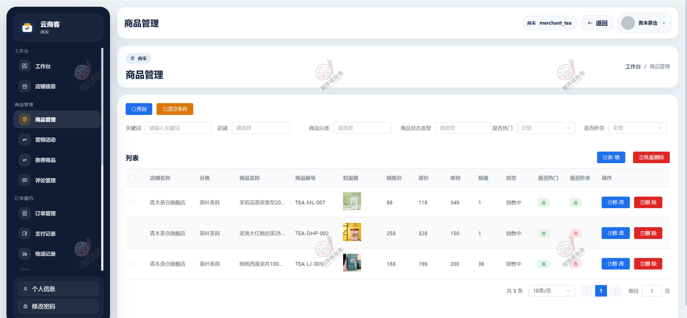

**营销活动**
顶部三张计数卡：打折活动 0、秒杀活动 1、进行中活动 0。页面右上角有一句规则说明——打折活动按商品基准价自动换算活动价，秒杀活动单独维护秒杀价和限量库存，热销推荐已经拆到独立页面。列表按商品、营销类型、活动名称、折扣值、活动价、限购、库存、活动时间、活动内容排列，示例那条是茉莉花茶浓香型 200g 袋装的秒杀活动，活动价 ¥12，活动时间 2026-09-14 至 2026-09-15。

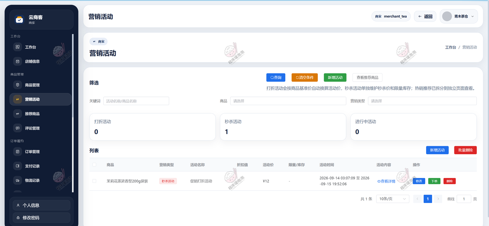

**推荐商品**
三张卡给出推荐商品数 3、秒杀商品数 1、平均销量 12.7。这一页最有价值的是中间那块"推荐规则"：销量权重、下单热度、评价修正三段说明，下面一行写明当前排序分值 = 销量权重 + 下单热度 + 好评修正。列表里明前西湖龙井 100g 礼盒装（¥168，销量 36）和茉莉花茶 200g 袋装（¥88，销量 1）都挂着"推荐商品"标签，后者还叠了"秒杀中"，可以直接下架或跳去查看商品。

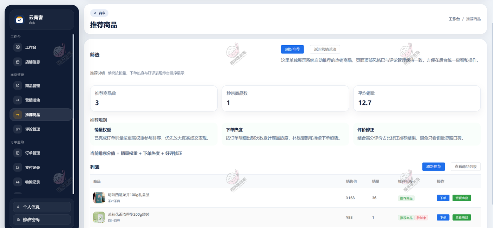

**订单管理**
筛选项很密：关键词、客户姓名、客户电话、店铺、订单状态、支付状态、支付方式，再加支付时间和发货时间两个区间。列表给订单号、客户姓名、客户电话、店铺名称、收货人、联系电话、商品金额。行内操作按订单当前状态变化——未发货的有"发货"，运输中的给"标记收货"，已完成的多出"售后"和"删除"，取消则单独一个按钮。

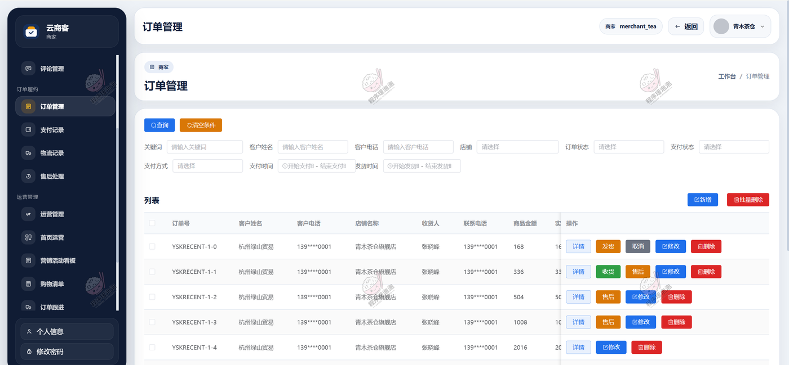

**支付记录**
和订单表一一对应，多了支付单号、支付方式、支付状态、支付时间、到账时间。截图里四种支付方式都出现了：余额 ¥168、微信 ¥336、支付宝 ¥504、银行卡 ¥1008，支付状态都是"支付成功"，到账时间和支付时间同秒，说明是走完流程才落库的。筛选项支持按支付方式和时间区间查。

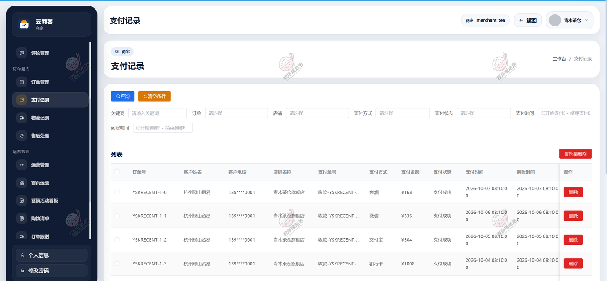

**物流记录**
按物流状态、打印时间、发货时间、签收时间筛。列表给出物流单号、物流公司（截图为顺丰速运）、面单打印次数、打印时间、发货时间，行内两个操作是"打印面单"和"删除"。打印次数单独记一列是个细节，重复打单的情况一眼能看出来。

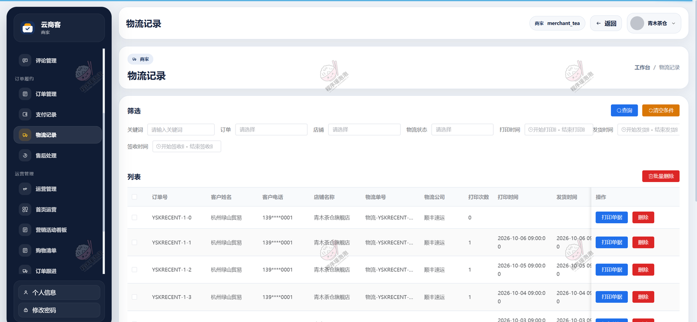

**售后处理**
按订单号、客户姓名、客户电话、店铺、售后类型、售后状态和申请时间筛。列表给商品名称、售后类型（退货 / 换货）、申请金额、凭证图片、售后状态、申请时间。截图四条记录里三条退货、一条换货，申请金额分别是 201.6、201.6、168、336，只有"处理中"那条右侧亮着"处理"按钮，已完成的只剩删除。

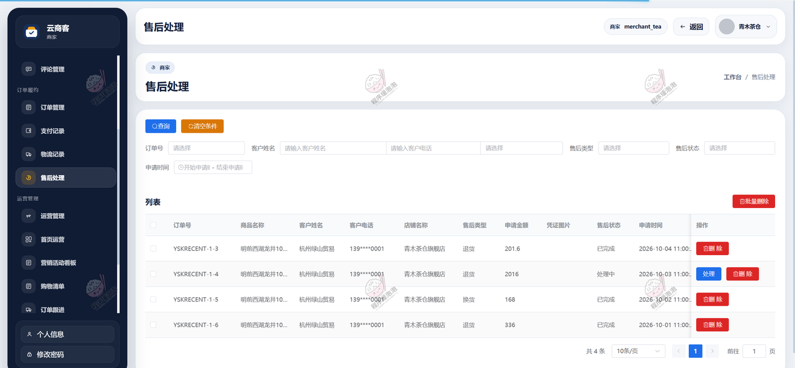

**购物清单**
这一页的定位在标题里写清楚了——集中管理待支付、待发货订单草稿。底下还有一句说明：把原来散在订单页里的代客下单入口、待支付订单和待发货订单集中到一个独立工作页。三张计数卡是待支付 2、待发货 1、本页草稿总数 3，右上角两个按钮是"新建代客订单"和"客户联系人"。列表带收货信息（收货人 / 电话）和实付金额，每行三个操作：编辑、去支付、跟进。

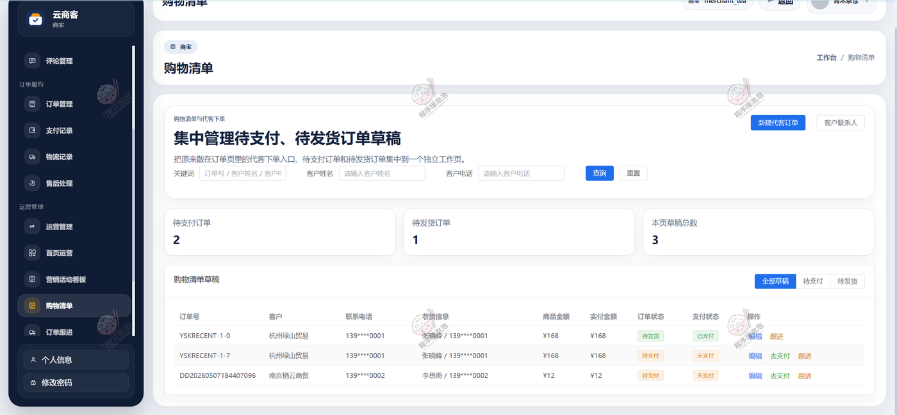

**订单跟进**
标题是"跟踪待发货、待收货和已完成订单的履约进度"，三张卡：待发货 1、待收货 2、已完成 6。列表同时给出订单状态和物流状态两列，订单状态涵盖待发货、待收货、已完成、退款中、已退款，物流信息是"顺丰速运 / 物流单号"的形式，签收时间为空的就是还没签。这里也能看出订单状态和物流状态是两条独立的状态线，不是同一个字段改个名字。

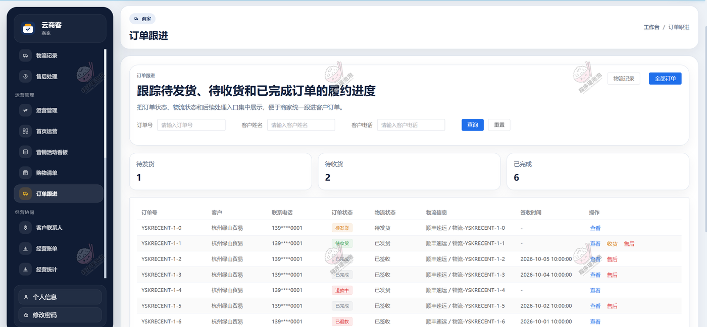

**经营统计**
六张卡片：总营收 ¥18502.00、总退款 ¥537.60、净收入 ¥17964.40、总利润 ¥8570.40、有效订单数 11、动销商品数 3。四个图分别是分类营收（茶叶类目）、分类利润、近 7 日营收与利润双折线（总营收 / 总利润两条线分开）、热销商品排行（明前西湖龙井 100g 礼盒装，营收 ¥18144.00）。

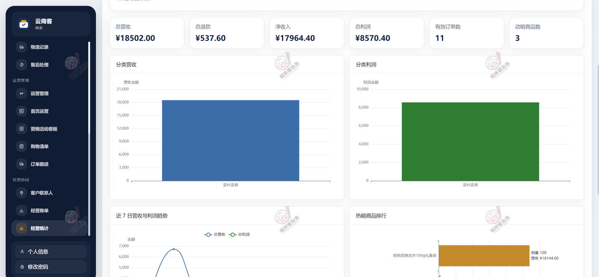

### 二、管理员端（平台后台）

管理员左侧菜单分五组：商家管理、商品分类管理、统计与结算、投诉处理。商家管理下细分商家账号、店铺信息、经营类型、商家处罚，统计与结算下细分平台经营统计和经营账单。

**店铺信息**
按关键词、商家账号、经营类型、店铺状态、入驻申请、退出申请六个条件筛。列表十列：商家账号、经营类型、店铺名称、联系人、联系电话、店铺状态、入驻申请、退出申请、申请说明、操作。四条记录刚好覆盖三种状态——麦田手作烘焙坊是待审核（操作列亮着"通过入驻 / 驳回入驻"），木光家居生活馆已通过但发起了退出、申请说明写"因线下活动暂停经营"，临江鲜生活鲜果的退出申请还在待审核（"通过退出"可点、"驳回退出"置灰），青木茶舍旗舰店是首批入驻、两个申请都是正常状态。经营类型分食品生鲜和家居生活两类。

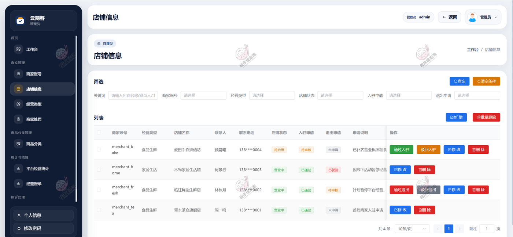

**经营账单**
这是平台的结算台账。一条记录包含店铺名称、结算周期类型（周 / 月）、周期起止、订单数、营业金额、退款金额、净营业额、平台比例、平台金额、商家金额、结算状态、结算时间、操作账号。三条记录都是 2026-10-01 至 2026-10-15、订单数 7、待结算：木光家居生活馆营业 2574、退款 124.8、净 2449.2、比例 10%、平台 244.92、商家 2204.28；青木茶舍旗舰店营业 11068、退款 537.6、净 10550.4、比例 8.5%、平台 896.78、商家 9653.62；临江鲜生活鲜果营业 3293.4、退款 159.68、净 3133.72、比例 9%、平台 282.03、商家 2851.69。三行的减法、乘法、减法全部对得上，说明金额不是手填的，是按比例算出来的。另外青木茶舍这一行的退款 537.6，和商家端经营统计卡里的总退款 ¥537.60 是同一个数，两端数据打通。

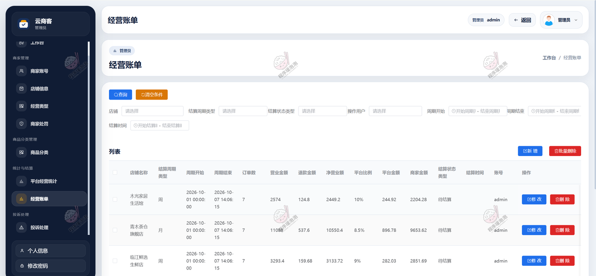

**投诉处理**
按关键词、客户姓名、客户电话、店铺、订单、投诉状态类型、处理用户和回复时间区间筛。列表给投诉标题、投诉内容、证据图片（点开看详情）、投诉状态、回复内容、回复时间。两条示例一条是"发货速度太慢"待处理，另一条是"取消订单后未及时退款"已解决、回复时间 2026-09-08。行内操作是处理中、已驳回、已关闭这几种状态流转，已解决的记录只剩关闭和删除。

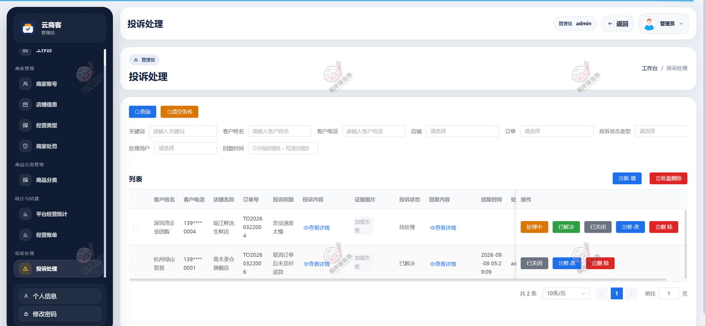

## 说明

- 文档展示 14 张截图，需要了解更多，请联系我。
- 截图中的店铺、商品、订单、金额均为演示数据，商家账号 `merchant_tea` / 管理员账号 `admin` 为初始演示账号。
- 系统按 B/S 架构部署，服务端 Spring Boot 3.3.1 + MySQL，前端 Vue 3 + Vite 打包后由 Nginx 托管。
